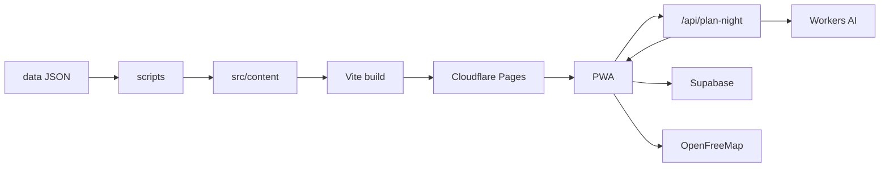

# Gusto's Guide

[Gusto's Guide](https://gustosguide.com) is Augusto Milano's personal food guide. The lists are his, and so are the scores: a house score from 1.0 to 10.0 on the places he has eaten, across Seattle, the Eastside, Los Angeles, San Francisco, San Diego, Portland, and Vancouver, and also New York, Pullman, and Moscow, Idaho. The public site is the guide itself. Sign in to mark Been and To go, rank places, keep your own lists, and plan a meal.

## Features

- **Curated guides.** Written lists, grouped as Best of, cuisine, occasion, drinks, and neighborhood.
- **Gusto's Score.** Published from the owner account, in tenths from 1.0 to 10.0. Top 25 is that region's Golden Fork list: open restaurants, one location per brand, ranked by the score.
- **Map and filters.** Explore is the open city on one map (Leaflet, MapLibre, and OpenFreeMap tiles). Filters cover cuisine, neighborhood, price, score band, Been or To go, open now, and distance.
- **Cheap eats, with cited prices.** A dollar tier is stored only when a source published it. `data/price-sources.json` and `data/price-sources-2026-11-11.json` record the source, the URL, and a one-line evidence string: an Apple Maps price range, an official site's schema.org `priceRange`, a Google Places `priceLevel`, a Google per-person line, or a tier Augusto supplied. A place with no cited tier stays unpriced. Cheap eats is the open `$` list for that city, ordered by Gusto's Score, or a stored collection when one is published.
- **Plan my night.** A sentence becomes an itinerary of places already in the guide: drinks, then dinner, then dessert, or a single list. The title follows the local clock (Plan my morning, Plan my afternoon, Plan my night). On Cloudflare Pages, `functions/api/plan-night.ts` asks Workers AI (`@cf/meta/llama-3.1-8b-instruct-fp8-fast`) for stop constraints: role, vibe, price, and neighborhood. The browser ranks the catalog, keeps stops within a walk, and keeps one stop per role. When that function is absent, rate-limited, or returns a fallback, the page uses the keyword planner in `src/lib/night-plan.ts`.
- **Tonight.** A separate shuffle of To go places that are open now, with vibe, price, and nearby.
- **Achievements.** Profile medals for Been and ranked milestones, neighborhoods, cuisines, cities, and guide sweeps.
- **Offline PWA.** Installable from `public/manifest.webmanifest`. The production service worker caches the shell network-first and hashed assets cache-first. Saved lists stay in `localStorage`. Uploaded photos are resized to WebP in the browser and kept in IndexedDB.

Sign-in is optional. With Supabase set, it is an email magic link (PKCE). `VITE_AUTH_PROVIDERS` can add Continue with X, Google, or Apple. Friends, the feed, shared lists, and dinner plans come from those accounts. A Yelp rating, when a place has one, is a small gray line under the house score.

## Stack

React 19, TypeScript, Vite, Tailwind CSS 4, React Router with hash routes, Leaflet and MapLibre, Framer Motion, Supabase, and Cloudflare Pages with one Pages Function.



Guide routes live in the hash (`#/explore`), so the host serves the static `dist/` folder. `/terms` and `/privacy` are real HTML files. `wrangler.jsonc` binds Workers AI as `AI` for the night planner. Publishing steps are in [DEPLOY.md](DEPLOY.md).

## Engineering notes

**Cited price ledger.** `scripts/price-sources.test.mjs` checks every ledger row against the catalog: city, name, dollar tier, source, URL shape, and evidence pattern.

**Photo pipeline.** Photos the owner uploads are credited "Photo by Gusto" and become the primary image. `npm run wikimedia` saves licensed Wikimedia Commons files into `public/photos/` with credit and license. `scripts/resize-photos.py` writes JPEG at 480 and 960 and WebP at 200, 400, 720, and 960. Remaining places use a labeled illustration. The build also writes `dist/pd/<id>.json` so a place link can paint before the rest of the city catalog arrives.

**Service worker.** `scripts/stamp-sw.mjs` names the cache after the commit that was built. Set `GUSTO_BUILD_SHA` to the full 40-character SHA when the build has no `.git` directory. The script refuses a short SHA.

**Tests.** `npm run test:e2e` runs Playwright in `e2e/` on Chromium at 1440×900 and WebKit at 390×844, against the dev server on port 4179. `npm run test:night` checks itinerary shape, walk legs, and the one-stop-per-role rule. `npm run test:stamp` checks the service-worker SHA. `npm run build` lints copy and typechecks before it writes `dist/`.

## Local development

```bash
npm install
npm run dev
```

The dev server is [http://127.0.0.1:4179](http://127.0.0.1:4179). Leave the variables unset and the app stays in this browser: lists, ranks, and scores in `localStorage`, and Plan my night on the keyword planner. Vite does not serve the Pages Function, so `/api/plan-night` is the production path.

| Variable | Role |
| --- | --- |
| `VITE_SUPABASE_URL` | Supabase project URL. Set together with the key below, or leave both unset. |
| `VITE_SUPABASE_ANON_KEY` | Publishable key. The browser sends it as `apikey`. |
| `VITE_AUTH_PROVIDERS` | Comma list. `x`, `google`, and `apple` each show that button. |
| `VITE_DEMO_FRIENDS` | `1` on a dev server seeds friends. Production builds ignore it. |
| `SITE_URL` | Origin for the sitemap and share pages. Defaults to `https://gustosguide.com`. |
| `GUSTO_BUILD_SHA` | Full 40-character commit SHA for a build with no `.git` directory. |
| `CF_WEB_ANALYTICS_TOKEN` | Optional token stamped into the Pages build. |
| `FOURSQUARE_API_KEY` | Read by `npm run photos`, which exits without fetching. |

Apply `supabase/schema.sql` on a new project. Later changes are in `supabase/migrations/`. Auth redirect URLs and the owner flag that publishes Gusto's Score are in [DEPLOY.md](DEPLOY.md).

```bash
npm run lint
npm run test:night
npm run test:e2e
npm run build
npm run preview
```

`npm run content` regenerates the Seattle files in `src/content/` from `data/`. The Eastside, Los Angeles, and later cities are maintained as their own catalog files.

## Project structure

```
src/            React app: pages, components, scoring, search, maps, the night planner
src/content/    City catalogs and guides the app ships
src/social/     Supabase client, account sync, local import
functions/api/  Pages Function that reads a night sentence with Workers AI
public/         Service worker, manifest, photos, legal pages, icons
data/           Source lists, price ledger, exclusions, Wikimedia cache
scripts/        Content build, photo fetch and resize, sitemap, stamps, checks
e2e/            Playwright
supabase/       Schema, migrations, auth email templates
```

## Live

[gustosguide.com](https://gustosguide.com)
